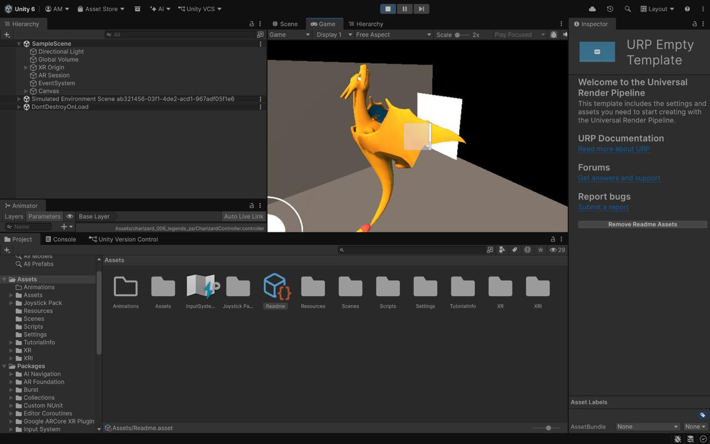
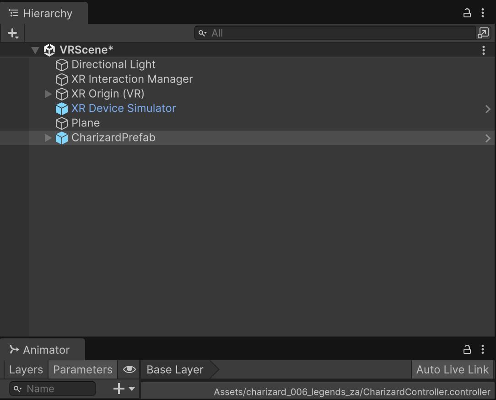
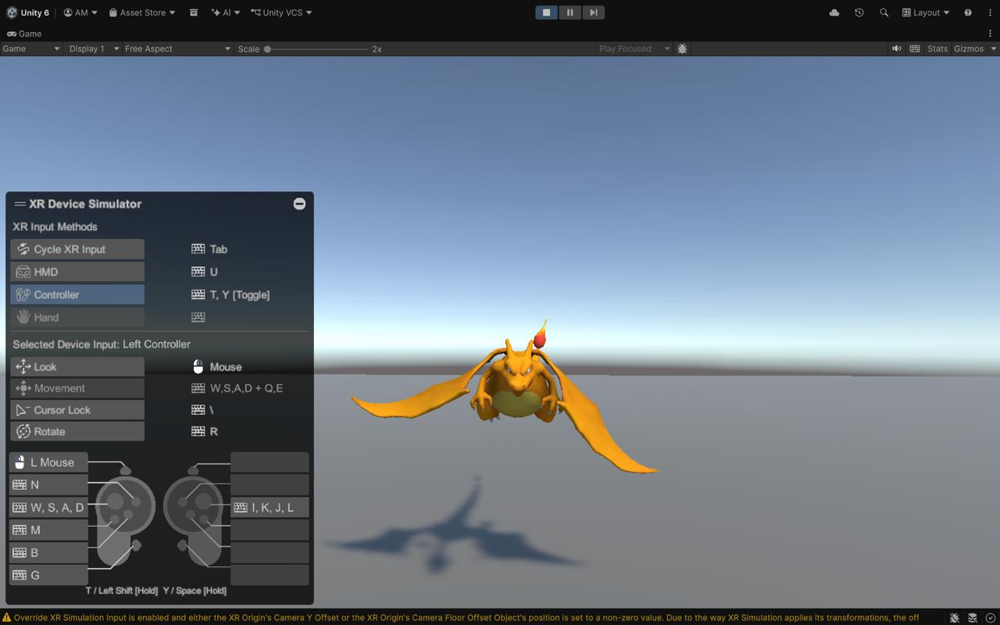
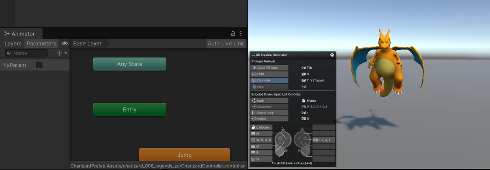
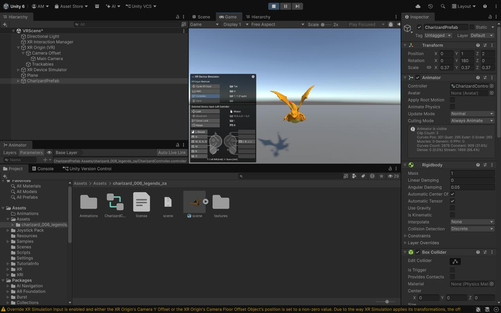

# AR Dragon — ISE 1 + ISE 2 (ARVR 7CS432)

**Walchand College of Engineering, Sangli | B.Tech Sem VII CS | AY 2026-27**  
**Course:** Augmented and Virtual Reality (7CS432)  
**Repository:** https://github.com/aditimittal38/AR-Dragon-1  
**Demo Link (Drive):** https://drive.google.com/drive/folders/1SxAB9H3kbnMbqN72Miyn0bjewZP0tV-f?usp=sharing

---

## What This Project Does

| Scene | Mode | Description |
|---|---|---|
| `SampleScene` | **AR (ISE 1)** | Spawns a Charizard 3D model on a detected image using AR Foundation + ARCore. Joystick controls movement and animation. |
| `VRScene` | **VR (ISE 2)** | VR environment with XR Interaction Toolkit. Navigate with the XR Device Simulator (WASD + mouse). Grab Charizard with a VR controller to trigger its flying animation. |

---

## ISE 2 — VRTK Implementation

### Assignment Brief
> "How to use VRTK? You can implement by any method, as we studied in Module 5. Take reference of ISE 1 and try to implement the VRTK method on that."

### Why XR Interaction Toolkit (XRI) Instead of VRTK

VRTK is not compatible with Unity 6 (this project uses Unity 6.5.10f1 + URP 17.5.0). Upgrading VRTK would require downgrading the engine, which would break the ISE 1 AR Foundation scene.

Module 5 lists **XR Interaction Toolkit** as a VRTK alternative — it provides the same core features: grab interactions, teleportation, locomotion, and snap turning. XRI 3.0.11 was already present in `Packages/manifest.json`.

---

## Tech Stack

| Layer | Package / Version |
|---|---|
| Engine | Unity 6.5 (6000.5.10f1) |
| Render Pipeline | URP 17.5.0 |
| VR Framework | XR Interaction Toolkit 3.0.11 |
| AR Framework | AR Foundation 6.5.0 + ARCore 6.5.0 |
| Input | Unity Input System 1.20.0 |
| 3D Model | Charizard (glTF, `charizard_006_legends_za`) |

---

## VRScene — What Was Built

```
VRScene
├── Directional Light
├── XR Interaction Manager       ← routes all XRI events
├── XR Origin (VR)               ← camera rig + controllers
│   ├── Camera Offset
│   │   └── Main Camera
│   └── Trackables
│       ├── Left Controller Ray Interactor
│       └── Right Controller Ray Interactor
├── XR Device Simulator          ← keyboard/mouse VR simulation
├── Plane                        ← floor with TeleportationArea
└── CharizardPrefab
    ├── Animator                 ← flyParam bool controls animation
    ├── Rigidbody                ← IsKinematic=true, UseGravity=false
    ├── Box Collider             ← required by XRGrabInteractable
    ├── XR Grab Interactable     ← makes Charizard grabbable
    └── VR Dragon Interaction    ← custom script (see below)
```

### VRDragonInteraction.cs

Attach to CharizardPrefab alongside `XRGrabInteractable`. Listens to grab/release events and toggles the `flyParam` animator boolean.

```csharp
using UnityEngine;
using UnityEngine.XR.Interaction.Toolkit;
using UnityEngine.XR.Interaction.Toolkit.Interactables;

[RequireComponent(typeof(XRGrabInteractable))]
[RequireComponent(typeof(Animator))]
public class VRDragonInteraction : MonoBehaviour
{
    private XRGrabInteractable grabInteractable;
    private Animator animator;

    private void Awake()
    {
        grabInteractable = GetComponent<XRGrabInteractable>();
        animator = GetComponent<Animator>();
    }

    private void OnEnable()
    {
        grabInteractable.selectEntered.AddListener(OnGrabbed);
        grabInteractable.selectExited.AddListener(OnReleased);
    }

    private void OnDisable()
    {
        grabInteractable.selectEntered.RemoveListener(OnGrabbed);
        grabInteractable.selectExited.RemoveListener(OnReleased);
    }

    private void OnGrabbed(SelectEnterEventArgs args)  => animator.SetBool("flyParam", true);
    private void OnReleased(SelectExitEventArgs args)  => animator.SetBool("flyParam", false);
}
```

### Animation Behavior

| `flyParam` | Animation | When |
|---|---|---|
| `false` | Slow idle hover | Default state — Charizard hovers gently |
| `true` | Fast active flying | On VR controller grab |

---

## XR Device Simulator Controls

| Key | Action |
|---|---|
| **Tab** | Cycle input mode (HMD → Controller → Hand) |
| **U** | Select HMD mode |
| **T / Y** | Toggle Left / Right Controller |
| **Mouse** | Look around (HMD) / Aim controller ray |
| **W A S D** | Move forward / back / strafe |
| **Q / E** | Move up / down |
| **G** | Trigger / Grab |
| **R** | Rotate controller |

---

## Screenshots

### ISE 1 — AR Dragon Starting Point


*SampleScene with AR Foundation — Charizard spawned on a detected reference image*

---

### VRScene — Complete Hierarchy and Inspector


*VRScene Hierarchy: XR Interaction Manager, XR Origin (VR), XR Device Simulator, Plane, CharizardPrefab all in place*

---

### XR Device Simulator — HMD Navigation Verified


*Play mode with HMD mode active — WASD, mouse look, and Q/E navigation confirmed working; Charizard visible in slow idle hover*

---

### flyParam Animation Effect


*Animator Parameters tab showing flyParam; unchecked = slow idle hover, checked = fast active flying*

---

### Final VRScene Look


*Final VRScene — Hierarchy, CharizardPrefab Inspector (Box Collider, XR Grab Interactable, VR Dragon Interaction, Rigidbody), and Game view*

---

### All Screenshots (Full List)

All 17 implementation screenshots are in [`Screenshots/`](Screenshots/).

| # | File | What It Shows |
|---|---|---|
| 1 | [1_ise1.png](Screenshots/1_ise1.png) | ISE 1 AR Dragon project — starting point |
| 2 | [2_import_xr_interation_tools.png](Screenshots/2_import_xr_interation_tools.png) | Importing XRI Starter Assets in Package Manager |
| 3 | [3_create_new_scene.png](Screenshots/3_create_new_scene.png) | Creating a new URP scene (VRScene) |
| 4 | [4_delete_main_camera.png](Screenshots/4_delete_main_camera.png) | Default camera deleted; VRScene with only Directional Light |
| 5 | [5_XR_device_simulator_prefab.png](Screenshots/5_XR_device_simulator_prefab.png) | XR Device Simulator prefab located in Samples folder |
| 6 | [6_add_componnets_locomotion_etc.png](Screenshots/6_add_componnets_locomotion_etc.png) | Locomotion System + Teleportation Provider + Snap Turn on XR Origin |
| 7 | [7_add_3dobject_plane.png](Screenshots/7_add_3dobject_plane.png) | Adding a floor Plane via GameObject > 3D Object |
| 8 | [8_add_component_plane.png](Screenshots/8_add_component_plane.png) | TeleportationArea component added to the Plane |
| 9 | [9_find_charizard_prefab.png](Screenshots/9_find_charizard_prefab.png) | CharizardPrefab located in Project browser |
| 10 | [10_copy_charizard_prefab_to_hierarchy.png](Screenshots/10_copy_charizard_prefab_to_hierarchy.png) | CharizardPrefab dragged into VRScene Hierarchy |
| 11 | [11_add_box_xollider.png](Screenshots/11_add_box_xollider.png) | Box Collider added to CharizardPrefab |
| 12 | [12_add_xr_grab_interactable.png](Screenshots/12_add_xr_grab_interactable.png) | XR Grab Interactable (Movement Type: Kinematic) |
| 13 | [13_add_vr_dragon_interaction.png](Screenshots/13_add_vr_dragon_interaction.png) | VR Dragon Interaction script added |
| 14 | [14_xr_controller.png](Screenshots/14_xr_controller.png) | Play mode — XR Device Simulator Controller mode |
| 15 | [15_HMD_controls_working_WASDQE.png](Screenshots/15_HMD_controls_working_WASDQE.png) | HMD navigation verified with WASD + mouse |
| 16 | [16_fly_param_effect.png](Screenshots/16_fly_param_effect.png) | Animator showing flyParam; Charizard in fast fly pose |
| 17 | [17_complete_final_look.png](Screenshots/17_complete_final_look.png) | Complete VRScene — Hierarchy, Inspector, Game view |

---

## Results

| Feature | Status |
|---|---|
| HMD navigation (WASD, mouse, Q/E) | Verified |
| Charizard idle hover animation | Verified |
| Charizard active fly animation (flyParam) | Verified |
| VRDragonInteraction script (compile + event wiring) | Verified |
| Teleportation Area on floor plane | Configured |
| XR controller grab (runtime) | Partial — requires physical OpenXR controller |

---

## Demo Video

https://drive.google.com/drive/folders/1SxAB9H3kbnMbqN72Miyn0bjewZP0tV-f?usp=sharing

---

## Known Limitations

- VRTK is not compatible with Unity 6 — XRI 3.0.11 used instead (Module 5 alternative).
- No physical VR headset available — all testing done with XR Device Simulator on Mac M1.
- Locomotion System and Snap Turn Provider show deprecation warnings in XRI 3.0.0; still functional.
- Controller grab runtime interaction not confirmed without physical hardware.

---

## How to Run

1. Clone: `git clone https://github.com/aditimittal38/AR-Dragon-1.git`
2. Open in **Unity 6.5** (6000.5.10f1) — do not upgrade the project.
3. In Window > Package Manager, ensure XRI 3.0.11 Samples are imported (Starter Assets + XR Device Simulator).
4. Open **VRScene** (Assets/Scenes/VRScene.unity) for the VR scene.
5. Open **SampleScene** for the ISE 1 AR scene (requires Android + ARCore build target).
6. Press Play in VRScene. Use Tab to cycle input modes in the XR Device Simulator overlay.

---

## Project Structure

```
AR-Dragon-1/
├── Assets/
│   ├── Assets/charizard_006_legends_za/   ← 3D model + animations
│   ├── Scenes/
│   │   ├── SampleScene.unity              ← ISE 1 AR scene
│   │   └── VRScene.unity                  ← ISE 2 VR scene
│   ├── Scripts/
│   │   ├── ARTrackedImageSpawner.cs       ← ISE 1: spawns dragon on image
│   │   ├── CharizardController.cs         ← ISE 1: joystick movement
│   │   └── VRDragonInteraction.cs         ← ISE 2: grab → fly animation
│   └── Samples/XR Interaction Toolkit/3.0.11/
│       ├── Starter Assets/
│       └── XR Device Simulator/
├── Screenshots/                           ← ISE 2 implementation screenshots
└── Packages/manifest.json                 ← XRI 3.0.11 + AR Foundation 6.5
```
